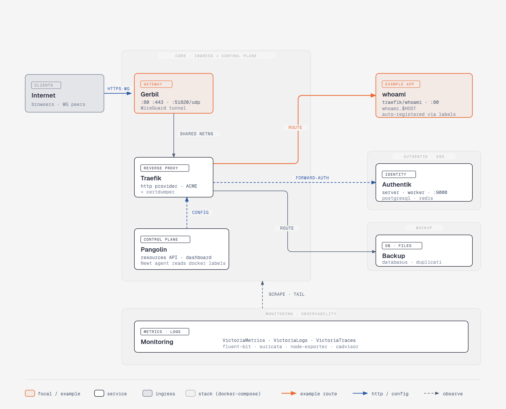

# JohnCloud Platform

## Architecture de la plateforme



Le diagramme se lit autour d'un bloc central, **CORE · INGRESS + CONTROL PLANE**, qui
regroupe l'ingress et le plan de contrôle.

**Ingress.** Les clients (navigateurs, pairs WireGuard) atteignent la plateforme en
`HTTPS·WG` sur **Gerbil**, la passerelle (ports `:80`, `:443`, `:51820/udp`, tunnel
WireGuard). Gerbil partage son namespace réseau (`SHARED NETNS`) avec **Traefik**, le
reverse proxy (provider HTTP, ACME + certdumper), qui termine le TLS et route le trafic.

**Plan de contrôle.** **Pangolin** (API `resources` + dashboard) fournit la configuration
à Traefik (`CONFIG`) ; son agent **Newt** lit les labels Docker pour enregistrer
automatiquement les services.

**Routes sortantes.** Traefik dessert trois destinations :

- **whoami** (*Example App*, `traefik/whoami`, `:80`, `whoami.$HOST`) — service de
  démonstration auto-enregistré via les labels Docker, atteint par la route de bout en
  bout mise en évidence en orange.
- **Authentik** (*SSO · Identity*, `server` · `worker` · `:9000`, PostgreSQL + Redis) —
  interrogé en `FORWARD-AUTH` pour l'authentification des requêtes.
- **Backup** (*DB · Files*, `databasus` · `duplicati`) — sauvegarde des bases et fichiers.

**Observabilité.** Le bloc **MONITORING** (VictoriaMetrics · VictoriaLogs · VictoriaTraces,
plus `fluent-bit`, `suricata`, `node-exporter`, `cadvisor`) collecte métriques et logs du
core (`SCRAPE · TAIL`).

La légende distingue les blocs *focal / example* (orange), *service*, *ingress* et *stack
(docker-compose)*, ainsi que les types de flèches : route d'exemple (orange), http / config
(bleu plein) et observation (bleu pointillé).

> Sources du diagramme : `platform-architecture.html` (éditable) et `platform-architecture.png`.

## Mise en place du Docker rootless

**Arrêter le démon rootful**:

```bash
sudo systemctl disable docker.service docker.socket
sudo systemctl stop docker.service docker.socket
```

Installer le mode rootless :

```bash
dockerd-rootless-setuptool.sh install
systemctl --user enable docker
systemctl --user start docker
```

Vérifiez ensuite que le mode rootless fonctionne :

```bash
dockerd-rootless-setuptool.sh install
systemctl --user status docker
docker info | grep -i rootless
docker run --rm hello-world
```

Si `docker info` n'affiche pas `rootless`, c'est que votre client utilise encore le socket rootful : revérifiez la variable `DOCKER_HOST`.

Avec le mode rootless, le démon ne peut pas ouvrir les ports inférieurs à 1024 par défaut. Il faut donc autoriser cette liaison une fois, avec les droits root.

**Abaisser le seuil des ports non privilégiés via sysctl**

Cette méthode s'applique à tout le système :

```bash
sudo sysctl net.ipv4.ip_unprivileged_port_start=80
echo 'net.ipv4.ip_unprivileged_port_start=80' | sudo tee /etc/sysctl.d/99-unprivileged-ports.conf
```

Avec la valeur `80`, les ports 80 et 443 deviennent accessibles à tous les utilisateurs. Cette option est plus large que la précédente, car elle concerne tous les processus de la machine.

**Vérification**

```bash
docker ps
ss -tlnp | grep -E ':(80|443)\b'
curl -I http://localhost
```

Si le conteneur ne démarre pas avec « permission denied » ou « bind: permission denied », vérifiez d'abord que le démon utilisé est bien le rootless (`docker info | grep -i rootless`) et que le `DOCKER_HOST` pointe vers `$XDG_RUNTIME_DIR/docker.sock`.
