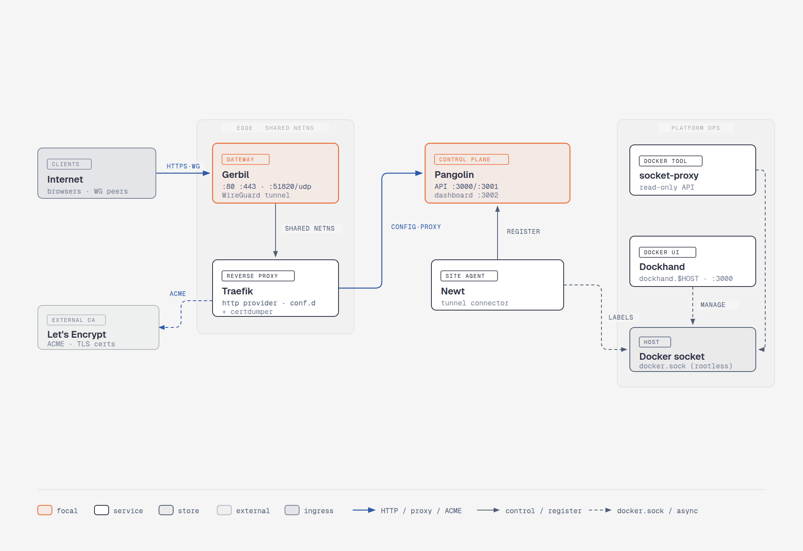

# JohnCloud Platform

## Architecture du cœur (core)



Le trafic entrant arrive sur **Gerbil** (passerelle WireGuard, ports `80`/`443`/`51820`),
qui partage son namespace réseau avec **Traefik** (reverse proxy, provider HTTP + certdumper).
Traefik obtient ses certificats TLS auprès de **Let's Encrypt** (ACME) et récupère sa
configuration depuis **Pangolin**, le plan de contrôle (API `:3000`/`:3001`, dashboard `:3002`).
L'agent de site **Newt** s'enregistre auprès de Pangolin et établit le tunnel.

Côté exploitation (*Platform Ops*), **socket-proxy** expose une API Docker en lecture seule
et **Dockhand** fournit l'interface de gestion des conteneurs, tous deux s'appuyant sur le
`docker.sock` **rootless** de l'hôte.

> Sources du diagramme : `core/core-architecture.html` (éditable), `core/core-architecture.svg`
> et `core/core-architecture.png`.

## Mise en place du Docker rootless

**Arrêter le démon rootful**:

```bash
sudo systemctl disable docker.service docker.socket
sudo systemctl stop docker.service docker.socket
```

Installer le mode rootless :

```bash
dockerd-rootless-setuptool.sh install
systemctl --user enable docker
systemctl --user start docker
```

Vérifiez ensuite que le mode rootless fonctionne :

```bash
dockerd-rootless-setuptool.sh install
systemctl --user status docker
docker info | grep -i rootless
docker run --rm hello-world
```

Si `docker info` n'affiche pas `rootless`, c'est que votre client utilise encore le socket rootful : revérifiez la variable `DOCKER_HOST`.

Avec le mode rootless, le démon ne peut pas ouvrir les ports inférieurs à 1024 par défaut. Il faut donc autoriser cette liaison une fois, avec les droits root.

**Abaisser le seuil des ports non privilégiés via sysctl**

Cette méthode s'applique à tout le système :

```bash
sudo sysctl net.ipv4.ip_unprivileged_port_start=80
echo 'net.ipv4.ip_unprivileged_port_start=80' | sudo tee /etc/sysctl.d/99-unprivileged-ports.conf
```

Avec la valeur `80`, les ports 80 et 443 deviennent accessibles à tous les utilisateurs. Cette option est plus large que la précédente, car elle concerne tous les processus de la machine.

**Vérification**

```bash
docker ps
ss -tlnp | grep -E ':(80|443)\b'
curl -I http://localhost
```

Si le conteneur ne démarre pas avec « permission denied » ou « bind: permission denied », vérifiez d'abord que le démon utilisé est bien le rootless (`docker info | grep -i rootless`) et que le `DOCKER_HOST` pointe vers `$XDG_RUNTIME_DIR/docker.sock`.
