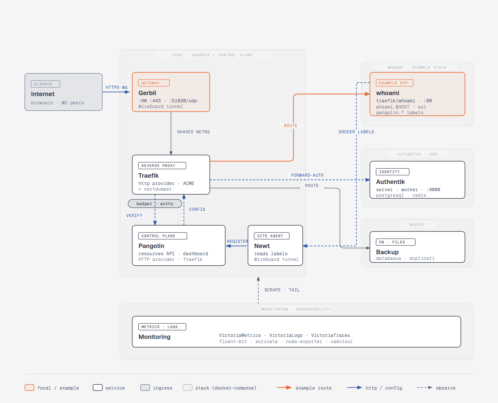

# JohnCloud Platform

## Platform architecture



The diagram is read around a central block, **CORE · INGRESS + CONTROL PLANE**, which
groups the ingress and the control plane.

**Ingress.** Clients (browsers, WireGuard peers) reach the platform over `HTTPS·WG` on
**Gerbil**, the gateway (ports `:80`, `:443`, `:51820/udp`, WireGuard tunnel). Gerbil
shares its network namespace (`SHARED NETNS`) with **Traefik**, the reverse proxy (HTTP
provider, ACME + certdumper), which terminates TLS and routes the traffic.

**Control plane.** **Pangolin** (`resources` API + dashboard) provides the configuration to
Traefik (`CONFIG`). Its site agent **Newt** establishes the WireGuard tunnel and watches
the stacks' Docker labels.

**Label-driven configuration.** The example stack **whoami** (`WHOAMI · EXAMPLE STACK`,
docker-compose) illustrates the mechanism: the `traefik/whoami` container carries no
hard-coded route, only `pangolin.public-resources.*` labels (domain `$HOST`, port `80`,
`ssl=true`, healthcheck, maintenance page). Newt reads these `DOCKER LABELS` (dashed arrow
from whoami), `REGISTER`s the resource with Pangolin, which then pushes the configuration to
Traefik. The public request then follows the end-to-end route highlighted in orange
(Gerbil → Traefik → whoami). Adding a service therefore comes down to declaring these labels
on its stack.

**Access control (`badger` middleware).** Traefik loads the `badger` plugin
(`github.com/fosrl/badger`), applied as middleware on the Pangolin routers and on the
exposed resources. On every request, `badger` queries Pangolin (`VERIFY`) to validate the
session and permissions: an unauthenticated request is redirected to the SSO login page, an
authorized request continues to the backend. It is what distinguishes public resources from
protected resources declared via the labels.

**Other destinations.** Traefik also serves:

- **Authentik** (*SSO · Identity*, `server` · `worker` · `:9000`, PostgreSQL + Redis) —
  identity provider, wired in as a `forwardAuth` middleware (`FORWARD-AUTH`) for resources
  protected directly by Authentik SSO.
- **Backup** (*DB · Files*, `databasus` · `duplicati`) — backup of databases and files.

**Observability.** The **MONITORING** block (VictoriaMetrics · VictoriaLogs · VictoriaTraces,
plus `fluent-bit`, `suricata`, `node-exporter`, `cadvisor`) collects the core's metrics and
logs (`SCRAPE · TAIL`).

The legend distinguishes the *focal / example* (orange), *service*, *ingress* and *stack
(docker-compose)* blocks, as well as the arrow types: example route (orange), http / config
(solid blue) and observation (dashed blue).

> Diagram sources: `platform-architecture.html` (editable) and `platform-architecture.png`.

## Use cases

The platform's reference scenarios are described as sequence diagrams in the
[`docs/use-cases/`](docs/use-cases/) folder:

- [Add a new service](docs/use-cases/new-service.md) — registering a stack with Pangolin and
  the automatic configuration of Traefik.
- [Access an unprotected service](docs/use-cases/access-unprotected-service.md) — the path of a
  request to a public resource.
- [Access a service protected by Authentik SSO](docs/use-cases/access-pangolin_sso-service.md) —
  access control via the Authentik `forwardAuth` middleware.
- [Access a service protected by Pangolin SSO](docs/use-cases/acess-authentik_sso-service.md) —
  access control via the Pangolin `badger` middleware.

## Setting up rootless Docker

**Stop the rootful daemon**:

```bash
sudo systemctl disable docker.service docker.socket
sudo systemctl stop docker.service docker.socket
```

Install rootless mode:

```bash
dockerd-rootless-setuptool.sh install
systemctl --user enable docker
systemctl --user start docker
```

Then verify that rootless mode is working:

```bash
systemctl --user status docker
docker info | grep -i rootless
docker run --rm hello-world
```

If `docker info` does not show `rootless`, your client is still using the rootful socket: double-check the `DOCKER_HOST` variable.

In rootless mode, the daemon cannot open ports below 1024 by default. You therefore need to allow this binding once, with root privileges.

**Lower the unprivileged ports threshold via sysctl**

This method applies system-wide:

```bash
sudo sysctl net.ipv4.ip_unprivileged_port_start=80
echo 'net.ipv4.ip_unprivileged_port_start=80' | sudo tee /etc/sysctl.d/99-unprivileged-ports.conf
```

With the value `80`, ports 80 and 443 become accessible to all users. This option is broader than the previous one, since it concerns every process on the machine.

**Verification**

```bash
docker ps
ss -tlnp | grep -E ':(80|443)\b'
curl -I http://localhost
```

If the container fails to start with "permission denied" or "bind: permission denied", first check that the daemon in use is indeed the rootless one (`docker info | grep -i rootless`) and that `DOCKER_HOST` points to `$XDG_RUNTIME_DIR/docker.sock`.

**Docker network creation**

```bash
docker network create -d bridge --subnet=192.168.203.0/24 traefik-proxy
```

infisical init
