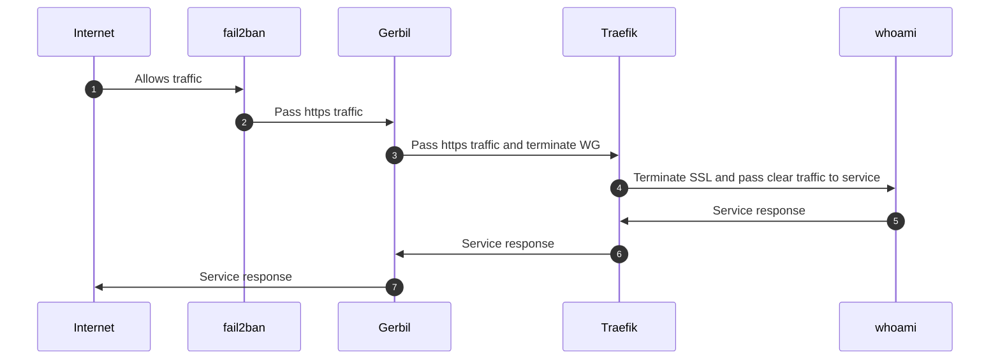

# Access an unprotected service

This scenario describes the path of a public request to an **unprotected resource**, that is,
one exposed without SSO access control. It is the shortest path: no identity provider is
consulted, only the network filtering layer (fail2ban) and TLS termination are involved.

## Step-by-step walkthrough

1. **Internet → fail2ban — `Allows traffic`.** The client's request arrives on the machine.
   **fail2ban** inspects the source: if the IP address is not banned (following abusive
   behavior detected by Suricata), the traffic is allowed to proceed.

2. **fail2ban → Gerbil — `Pass https traffic and terminate WG`.** The HTTPS traffic reaches
   **Gerbil**, the ingress gateway (ports `:80`, `:443`, `:51820/udp`). Gerbil terminates
   the WireGuard tunnel (`WG`) and forwards the traffic.

3. **Gerbil → Traefik — `Pass traffic`.** Gerbil shares its network namespace with
   **Traefik** (reverse proxy) and hands the traffic over for application routing.

4. **Traefik → whoami — `Terminate SSL and pass clear traffic to service`.** Traefik
   terminates TLS (Let's Encrypt certificate), identifies the router matching the requested
   domain and forwards the request in clear to the `whoami` backend container. Since the
   resource is unprotected, **no SSO middleware** is consulted.

5. **whoami → Traefik — `Service response`.** The service processes the request and returns
   its response to Traefik.

6. **Traefik → Gerbil — `Service response`.** Traefik re-encrypts the response and forwards
   it to Gerbil.

7. **Gerbil → Internet — `Service response`.** Gerbil returns the response to the client,
   closing the chain.
