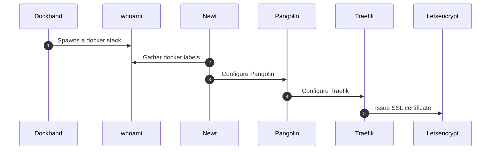

# Add a new service

This scenario describes the provisioning of a new stack on the platform. The guiding
principle is **label-driven configuration**: a service contains no hard-coded route, it
simply declares `pangolin.public-resources.*` Docker labels, and the rest of the chain
configures itself automatically.

## Step-by-step walkthrough

1. **Newt → whoami — `Gather docker labels`.** The site agent **Newt** watches the Docker
   containers of the deployed stacks. When a new service appears (here the example stack
   `whoami`), it reads its `pangolin.public-resources.*` labels: public domain (`$HOST`),
   container's internal port (`80`), TLS enablement (`ssl=true`), healthcheck and
   maintenance page.

2. **Newt → Pangolin — `Configure Pangolin`.** Newt registers (`REGISTER`) the discovered
   resource with **Pangolin**, the control plane. Pangolin thus keeps an up-to-date catalog
   of the exposed resources and their access rules.

3. **Pangolin → Traefik — `Configure Traefik`.** Pangolin pushes the corresponding dynamic
   configuration to **Traefik** (HTTP provider): creation of the router, the backend service
   and any middlewares (including `badger` for access control). Traefik reconfigures itself
   on the fly, without a restart.

4. **Traefik → Let's Encrypt — `Issue SSL certificate`.** For the new domain, Traefik
   triggers the ACME procedure with **Let's Encrypt** to obtain (and automatically renew)
   the TLS certificate. The service then becomes reachable over HTTPS.

Once these steps are complete, adding a service comes down to declaring the appropriate
labels on its stack: discovery, registration, routing and certificate issuance are fully
automated.
