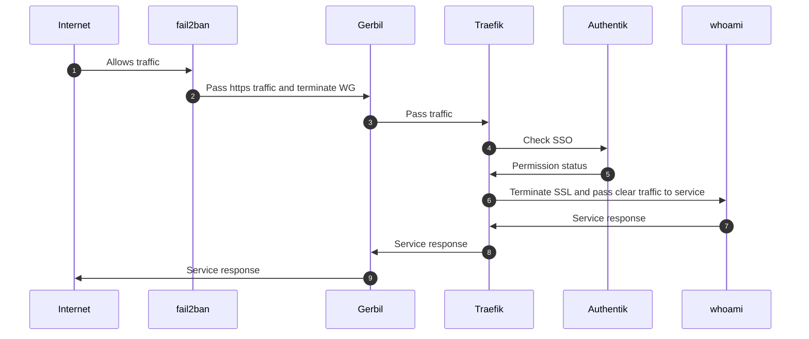

# Accéder à un service protégé par le SSO Authentik

Ce scénario décrit le parcours d'une requête publique vers une **ressource protégée par le
SSO Authentik**. Par rapport au service non protégé, une étape de vérification d'identité
s'intercale : Traefik interroge **Authentik** (fournisseur d'identité branché en
`forwardAuth`) avant de laisser la requête atteindre le backend.

## Déroulé étape par étape

1. **Internet → fail2ban — `Allows traffic`.** La requête du client arrive sur la machine.
   **fail2ban** vérifie que l'adresse IP source n'est pas bannie avant de laisser passer le
   trafic.

2. **fail2ban → Gerbil — `Pass https traffic and terminate WG`.** Le trafic HTTPS atteint
   **Gerbil**, la passerelle d'ingress, qui termine le tunnel WireGuard et transmet le
   trafic.

3. **Gerbil → Traefik — `Pass traffic`.** Gerbil remet le trafic à **Traefik** (reverse
   proxy) via le namespace réseau partagé.

4. **Traefik → Authentik — `Check SSO`.** La ressource étant protégée, Traefik applique le
   middleware `forwardAuth` et délègue la décision d'authentification à **Authentik**, le
   fournisseur d'identité. La session (cookie / en-têtes) est transmise pour vérification.

5. **Authentik → Traefik — `Permission status`.** Authentik répond avec le statut d'accès :
   - requête **non authentifiée** → redirection vers la page de connexion SSO Authentik ;
   - requête **autorisée** → Traefik poursuit vers le backend (étape suivante).

6. **Traefik → whoami — `Terminate SSL and pass clear traffic to service`.** Une fois
   l'accès validé, Traefik termine le TLS et transmet la requête en clair au conteneur
   backend `whoami`.

7. **whoami → Traefik — `Service response`.** Le service traite la requête et renvoie sa
   réponse à Traefik.

8. **Traefik → Gerbil — `Service response`.** Traefik rechiffre la réponse et la transmet à
   Gerbil.

9. **Gerbil → Internet — `Service response`.** Gerbil renvoie la réponse au client
   authentifié.
