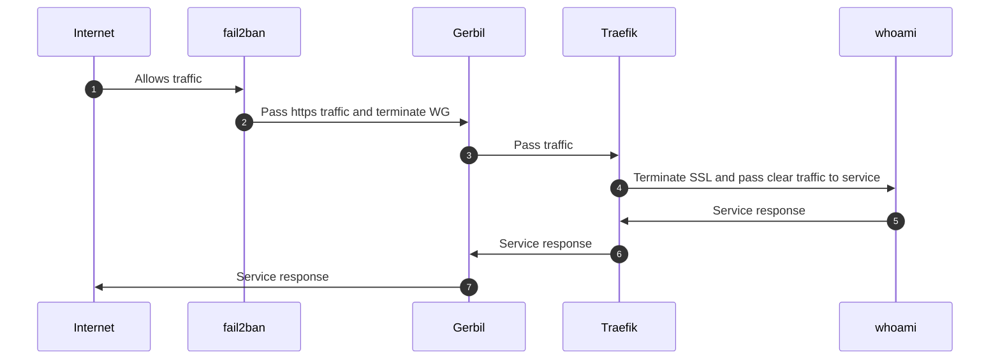

# Accéder à un service non protégé

Ce scénario décrit le parcours d'une requête publique vers une **ressource non protégée**,
c'est-à-dire exposée sans contrôle d'accès SSO. C'est le chemin le plus court : aucun
fournisseur d'identité n'est consulté, seule la couche de filtrage réseau (fail2ban) et la
terminaison TLS interviennent.

## Déroulé étape par étape

1. **Internet → fail2ban — `Allows traffic`.** La requête du client arrive sur la machine.
   **fail2ban** inspecte la source : si l'adresse IP n'est pas bannie (suite à des
   comportements abusifs détectés par Suricata), le trafic est autorisé à poursuivre.

2. **fail2ban → Gerbil — `Pass https traffic and terminate WG`.** Le trafic HTTPS atteint
   **Gerbil**, la passerelle d'ingress (ports `:80`, `:443`, `:51820/udp`). Gerbil termine
   le tunnel WireGuard (`WG`) et transmet le trafic.

3. **Gerbil → Traefik — `Pass traffic`.** Gerbil partage son namespace réseau avec
   **Traefik** (reverse proxy) et lui remet le trafic pour le routage applicatif.

4. **Traefik → whoami — `Terminate SSL and pass clear traffic to service`.** Traefik
   termine le TLS (certificat Let's Encrypt), identifie le router correspondant au domaine
   demandé et transmet la requête en clair au conteneur backend `whoami`. Comme la
   ressource n'est pas protégée, **aucun middleware SSO** n'est consulté.

5. **whoami → Traefik — `Service response`.** Le service traite la requête et renvoie sa
   réponse à Traefik.

6. **Traefik → Gerbil — `Service response`.** Traefik rechiffre la réponse et la transmet à
   Gerbil.

7. **Gerbil → Internet — `Service response`.** Gerbil renvoie la réponse au client, qui
   referme la chaîne.
