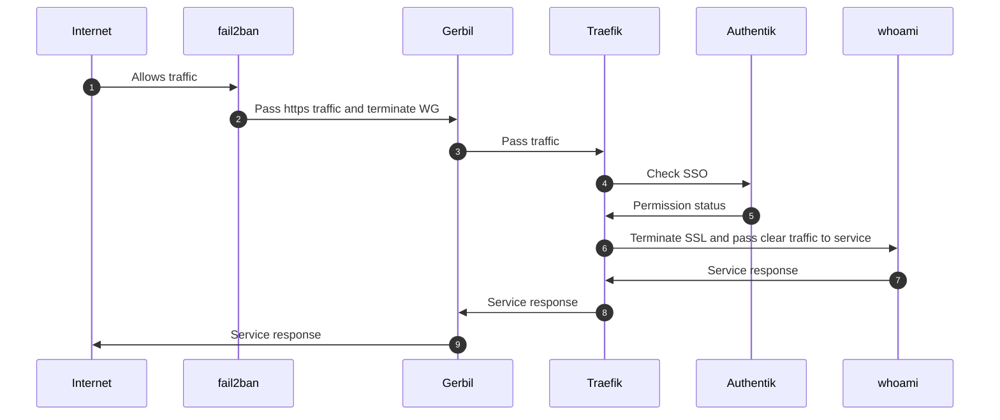

# Access a service protected by Authentik SSO

This scenario describes the path of a public request to a **resource protected by Authentik
SSO**. Compared to the unprotected service, an identity-verification step is inserted:
Traefik queries **Authentik** (identity provider wired in as `forwardAuth`) before letting
the request reach the backend.

## Step-by-step walkthrough

1. **Internet → fail2ban — `Allows traffic`.** The client's request arrives on the machine.
   **fail2ban** checks that the source IP address is not banned before letting the traffic
   through.

2. **fail2ban → Gerbil — `Pass https traffic and terminate WG`.** The HTTPS traffic reaches
   **Gerbil**, the ingress gateway, which terminates the WireGuard tunnel and forwards the
   traffic.

3. **Gerbil → Traefik — `Pass traffic`.** Gerbil hands the traffic to **Traefik** (reverse
   proxy) via the shared network namespace.

4. **Traefik → Authentik — `Check SSO`.** Since the resource is protected, Traefik applies
   the `forwardAuth` middleware and delegates the authentication decision to **Authentik**,
   the identity provider. The session (cookie / headers) is passed along for verification.

5. **Authentik → Traefik — `Permission status`.** Authentik responds with the access status:
   - an **unauthenticated** request → redirect to the Authentik SSO login page;
   - an **authorized** request → Traefik continues to the backend (next step).

6. **Traefik → whoami — `Terminate SSL and pass clear traffic to service`.** Once access is
   validated, Traefik terminates TLS and forwards the request in clear to the `whoami`
   backend container.

7. **whoami → Traefik — `Service response`.** The service processes the request and returns
   its response to Traefik.

8. **Traefik → Gerbil — `Service response`.** Traefik re-encrypts the response and forwards
   it to Gerbil.

9. **Gerbil → Internet — `Service response`.** Gerbil returns the response to the
   authenticated client.
