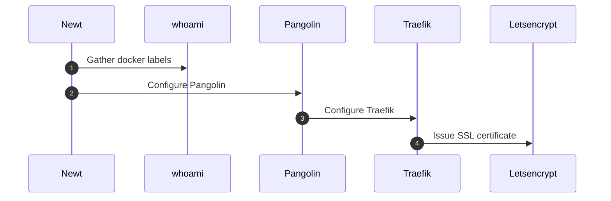

# Ajouter un nouveau service

Ce scénario décrit la mise en service (provisioning) d'une nouvelle stack sur la
plateforme. Le principe directeur est la **configuration par label** : un service ne
contient aucune route codée en dur, il déclare simplement des labels Docker
`pangolin.public-resources.*`, et le reste de la chaîne se configure automatiquement.

## Déroulé étape par étape

1. **Newt → whoami — `Gather docker labels`.** L'agent de site **Newt** surveille les
   conteneurs Docker des stacks déployées. À l'apparition d'un nouveau service (ici la
   stack d'exemple `whoami`), il lit ses labels `pangolin.public-resources.*` : domaine
   public (`$HOST`), port interne du conteneur (`80`), activation du TLS (`ssl=true`),
   healthcheck et page de maintenance.

2. **Newt → Pangolin — `Configure Pangolin`.** Newt enregistre (`REGISTER`) la ressource
   découverte auprès de **Pangolin**, le plan de contrôle. Pangolin tient ainsi à jour le
   catalogue des ressources exposées et leurs règles d'accès.

3. **Pangolin → Traefik — `Configure Traefik`.** Pangolin pousse la configuration
   dynamique correspondante vers **Traefik** (provider HTTP) : création du router, du
   service backend et des middlewares éventuels (dont `badger` pour le contrôle d'accès).
   Traefik se reconfigure à chaud, sans redémarrage.

4. **Traefik → Let's Encrypt — `Issue SSL certificate`.** Pour le nouveau domaine, Traefik
   déclenche la procédure ACME auprès de **Let's Encrypt** afin d'obtenir (et de
   renouveler automatiquement) le certificat TLS. Le service devient alors joignable en
   HTTPS.

Au terme de ces étapes, ajouter un service se résume à déclarer les labels adéquats sur sa
stack : la découverte, l'enregistrement, le routage et la délivrance du certificat sont
entièrement automatisés.
